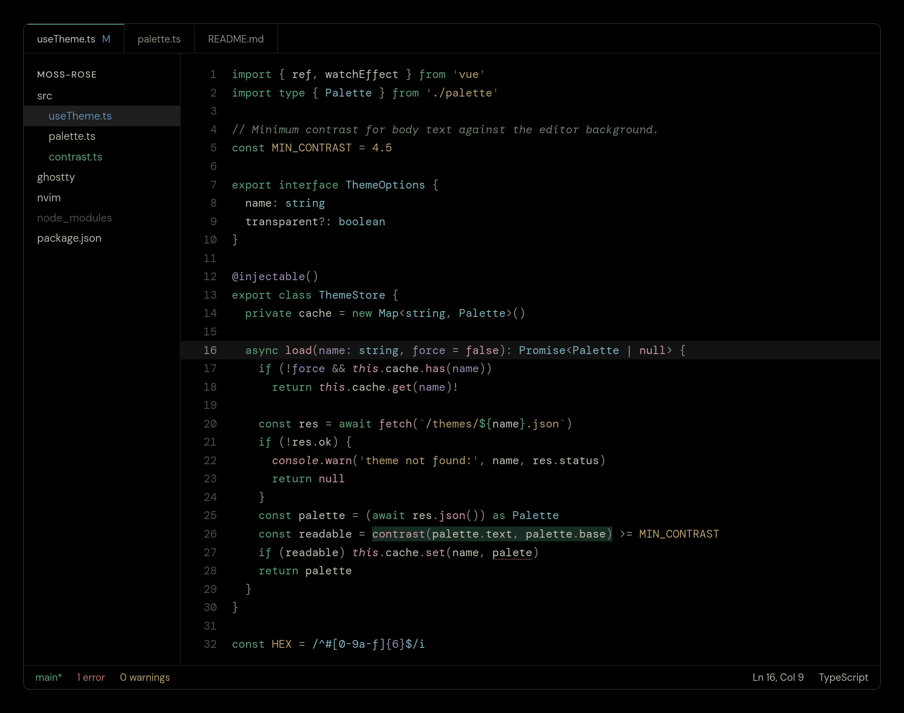
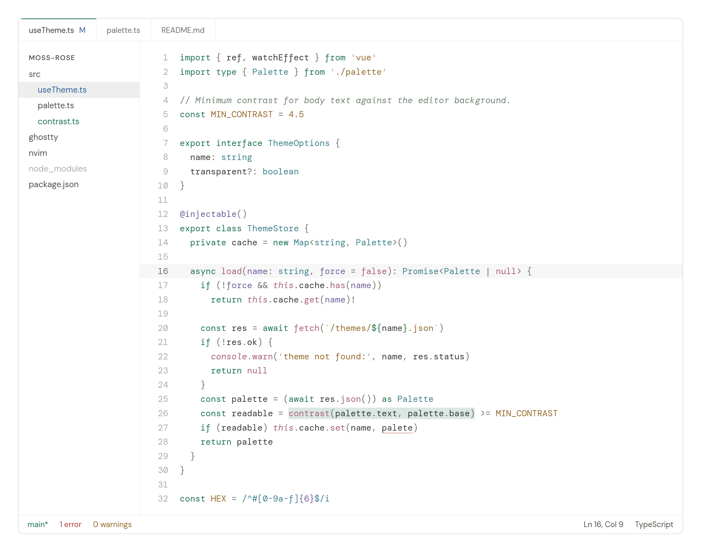
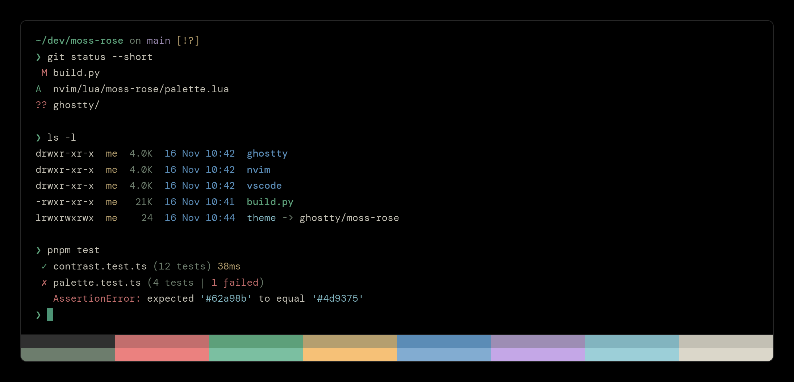
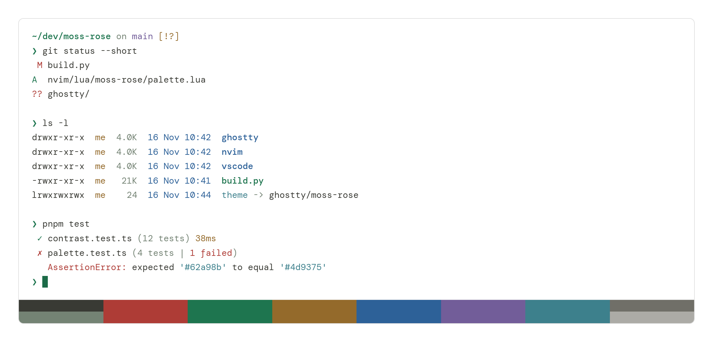

<h1 align="center">Moss Rose</h1>

<p align="center">
  Rosé Pine's syntax colors on a Vitesse canvas.<br>
  Dark and light, for Ghostty, VS Code and Neovim.
</p>

<p align="center">
  
</p>

<details>
<summary>Light variant and terminal</summary>
<br>
<p align="center">
  
  
  
</p>
</details>

<p align="center"><sub>Images are rendered from <a href="docs/preview.html">docs/preview.html</a>, which also shows sixteen languages and file formats.</sub></p>

## Install

Clone the repository, then follow the steps for each app you use.

```sh
git clone https://github.com/nlebedevinc/moss-rose.git ~/dev/moss-rose
```

| App | Variants | Steps |
|---|---|---|
| Ghostty | `moss-rose`, `moss-rose-light` | [ports/ghostty](ports/ghostty/README.md) |
| VS Code | Moss Rose, Moss Rose Light | [ports/vscode](ports/vscode/README.md) |
| Neovim 0.9+ | `moss-rose` (follows `background`), `moss-rose-light` | [ports/neovim](ports/neovim/README.md) |

## The idea

Two themes, each good at a different thing.

- **Vitesse** has the calm canvas: a neutral background, flat panels with hairline borders,
  and one green accent. Moss Rose takes all of that, including the green for keywords.
- **Rosé Pine** has the syntax colors: gold strings, rose functions, foam types, iris
  parameters. Moss Rose keeps those hues and roles.
- The accents are held to one narrow band of brightness and saturation, a step quieter
  than the text, so no color shouts over the others.
- Red means something is wrong. It is used for errors and deletions and nowhere else.

## Palette

| Role | Name | Dark | Light |
|---|---|---|---|
| Background | `base` | `#000000` | `#ffffff` |
| Text, variables | `text` | `#c3c0b4` | `#393a34` |
| Comments | `muted` | `#6d7d6d` | `#748374` |
| Keywords | `leaf` | `#5da07a` | `#1e754f` |
| Strings, numbers | `gold` | `#b59f6f` | `#946a2b` |
| Functions, booleans | `rose` | `#cc9ba2` | `#a75e7c` |
| Types, tags | `foam` | `#82b4bf` | `#3d808c` |
| Parameters, attributes | `iris` | `#9d8db4` | `#725d99` |
| Errors, deletions | `love` | `#c26e6d` | `#ae3c36` |
| Info, links | `sky` | `#5b8cb6` | `#2d6198` |
| UI accent, cursor | `pine` | `#4d9375` | `#1c6b48` |

The full set, with surfaces and greys, is in [`palette.toml`](palette.toml).

## Customize

Every port is generated from `palette.toml`. Change a color there and rebuild:

```sh
python3 tools/build.py
```

It needs Python 3.11 or newer and nothing else. With Pygments installed it also refreshes
the language gallery in the preview page.

Which role a color plays is decided per app: in `tools/ports/vscode.py` for VS Code and in
`ports/neovim/lua/moss-rose/init.lua` for Neovim.

## Repository layout

```
palette.toml           every color, for both variants
ports/<app>/           what each app installs
tools/build.py         regenerates every port from palette.toml
tools/ports/<app>.py   the generator for one app
samples/               one file per language, for checking the theme in a real editor
docs/preview.html      the preview page
```

To add an app, add `tools/ports/<app>.py` with a `build(themes)` function that returns
`{path: content}` for the files under `ports/<app>/`, and run the build. New modules are
picked up automatically; `tools/ports/ghostty.py` is the shortest example.

## Credits

Built on the palettes of [Rosé Pine](https://rosepinetheme.com) and
[Vitesse](https://github.com/antfu/vscode-theme-vitesse).

## License

[MIT](LICENSE)
